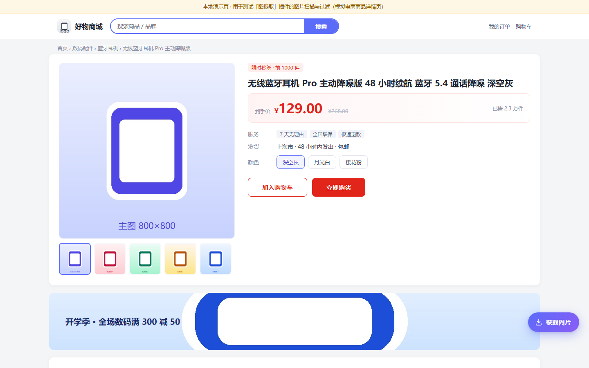

# 图提取 · ImageGrab

> 一键提取淘宝 / 天猫 / 京东 / 拼多多商家版商品详情页的所有图片，集中预览、自由勾选，批量下载为 PNG。

基于 **Manifest V3** 的 Chrome 浏览器扩展，纯本地运行，不上传任何数据。

- 在线官网：<https://sc30289.github.io/imagegrab/>
- 源码仓库：<https://github.com/Sc30289/imagegrab>



---

## 功能

| 能力 | 说明 |
| --- | --- |
| 悬浮按钮 | 仅在受支持的商品详情页右下角注入「获取图片」按钮，不遮挡页面操作 |
| 全面采集 | 支持 ``、`srcset`、`data-src`、`data-lazy-src`、`data-original`、`data-ks-lazyload`、内联与样式表里的 `background-image` |
| 智能过滤 | 剔除图标、logo、占位图、1×1 像素图，以及宽或高小于 100px 的图片 |
| 地址归一 | 自动补全相对路径、去掉 CDN 的缩放后缀还原原图、按地址去重 |
| 集中预览 | 新标签页网格展示，标注原始尺寸，可点「原图」单独查看 |
| 自由勾选 | 全选 / 反选 / 单张勾选，实时显示「已选 N / 共 M 张」 |
| 统一 PNG | jpg / webp / avif 等在 Service Worker 里通过 `OffscreenCanvas` 转为 PNG |
| 批量下载 | 文件名规则 `商品图_001.png`（序号补零），带进度与结果反馈 |

## 目录结构

```
imagegrab/
├── manifest.json          # MV3 配置：权限、匹配域名、内容脚本、Service Worker
├── content.js             # 内容脚本：注入悬浮按钮 + 扫描/过滤/去重图片
├── content.css            # 悬浮按钮与轻提示样式（igx- 前缀，避免样式污染）
├── background.js          # Service Worker：打开预览页、下载并转 PNG、回传进度
├── gallery.html           # 预览页结构
├── gallery.css            # 预览页样式
├── gallery.js             # 预览页逻辑：渲染网格、勾选、进度
├── icons/                 # 扩展图标 16 / 48 / 128
├── docs/                  # 官方宣传网站（纯静态，可直接部署）
├── demo/                  # 本地演示页 + chrome API 替身（不属于扩展本体）
└── screenshots/           # 截图与验收素材
```

## 安装

1. 下载并解压插件压缩包（或直接 clone 本仓库），建议放在纯英文路径下；
2. Chrome 地址栏输入 `chrome://extensions` 回车；
3. 打开右上角「开发者模式」；
4. 点击「加载已解压的扩展程序」，选择解压后的文件夹（含 `manifest.json` 的那一层）。

> Edge 同理：`edge://extensions`。

## 使用

1. 打开淘宝 / 天猫 / 京东 / 拼多多商家版的商品详情页；
2. 页面右下角出现「获取图片」按钮，点击后按钮会显示扫描进度；
3. 自动打开「图片预览」标签页，勾选需要的图片（默认全选）；
4. 点「下载选中」，图片统一转为 PNG 保存到浏览器默认下载目录，文件名 `商品图_001.png`、`商品图_002.png`……

## 本地演示（无需安装扩展）

`demo/` 目录内置了一个模拟电商详情页和一份最小化的 `chrome.*` API 替身，
可以在普通浏览器里直接预览扩展的完整交互：

```bash
# 在项目根目录起一个静态服务（扩展的 content script 需要 http 协议）
python -m http.server 8765
# 然后访问
#   http://127.0.0.1:8765/demo/product.html   ← 模拟商品详情页
#   http://127.0.0.1:8765/demo/preview.html   ← 预览页（演示版）
#   http://127.0.0.1:8765/docs/index.html     ← 官网
```

演示模式下点击「获取图片」会打开 `demo/preview.html`，界面与真实预览页一致；
「下载选中」会提示「演示模式：安装扩展后才会真正保存文件」。

## 实现要点

- **跨域转 PNG**：详情页图片存在防盗链，页面内 canvas 会被污染。扩展在 Service Worker 中用
  `fetch`（依赖 `host_permissions`）+ `createImageBitmap` + `OffscreenCanvas.convertToBlob` 完成转换；
  Service Worker 没有 `URL.createObjectURL`，因此转成 data URL 交给 `chrome.downloads.download`。
- **懒加载兼容**：不同平台属性命名不同，`content.js` 维护了一份 `LAZY_ATTRS` 列表统一扫描；
  `srcset` 取其中最大的一张；背景图除内联样式外，还会解析 `document.styleSheets` 里的规则。
- **原图归一**：淘宝 CDN 的 `_430x430q90.jpg`、`.jpg_.webp`，京东的 `/s450x450_jfs/`、`/n5/` 等
  缩放写法统一还原为原图地址；归一化后的地址若 404，会自动回退原始地址。
- **权限最小化**：仅申请 `activeTab / scripting / downloads / storage`。`host_permissions` 只放开三个平台的
  详情页域名，外加图片实际所在的 CDN（`alicdn.com`、`360buyimg.com`、`pddpic.com` 等）——没有这些域名，
  Service Worker 里的 `fetch` 会被 CORS 拦掉，转 PNG 那一步就没法做。

## 隐私

图片与页面信息只在本地浏览器内处理，不请求任何第三方接口，不上传任何数据。

## 开发

```bash
# 语法检查
node --check content.js && node --check background.js && node --check gallery.js

# 打包（生成 docs/downloads/imagegrab-v1.0.0.zip）
python tools/package.py
```

## 部署官网

`docs/` 是纯静态站点，可直接丢到 GitHub Pages / Vercel / Cloudflare Pages，
详见 [DEPLOY.md](DEPLOY.md)。

## License

MIT
